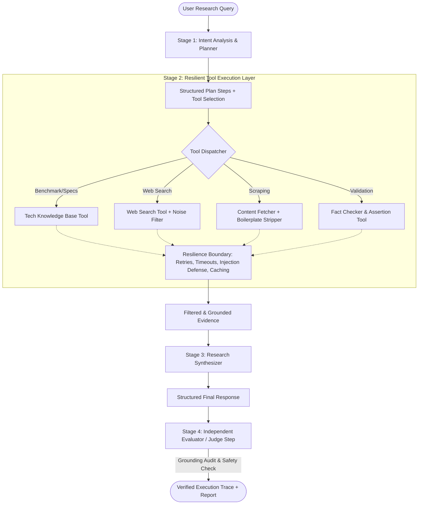

# Production-Oriented AI Research Agent

> An agentic research system engineered with explicit planning, multi-tool orchestration, resilient error boundaries, grounded citation synthesis, and automated judge auditing.

[](https://python.org)
[](https://pydantic.dev)
[]()
[]()

---

## 📑 Table of Contents
- [Architecture Overview](#-architecture-overview)
- [Why an Agentic Approach?](#-why-an-agentic-approach)
- [Tools Used and Why](#-tools-used-and-why)
- [Resilience & Handling Bad Tool Results](#-resilience--handling-bad-tool-results)
- [Hallucination Reduction & Citation Grounding](#-hallucination-reduction--citation-grounding)
- [Independent Judge & Evaluator Step](#-independent-judge--evaluator-step)
- [Production Readiness & Monitoring](#-production-readiness--monitoring)
- [Key Engineering Tradeoffs](#-key-engineering-tradeoffs)
- [Quickstart & Setup](#-quickstart--setup)
- [Evaluation & Test Results](#-evaluation--test-results)

---

## 🏛 Architecture Overview

The system implements a **Plan-Execute-Audit** pipeline:



---

## 💡 Why an Agentic Approach?

A standard, single-turn LLM generation fails on open-ended technical research queries for several critical reasons:
1. **Knowledge Cutoffs & Freshness**: Monolithic models cannot independently inspect live library releases, modern benchmarks, or recent funding/market shifts.
2. **Lack of Problem Decomposition**: Complex questions (e.g. comparing vector databases across latency, licensing, and operational overhead) require investigating multiple independent dimensions. Monolithic prompts conflate these steps, leading to superficial summaries.
3. **Unverifiable Assertions**: Without explicit tool invocation and citation grounding, an LLM generates plausible-sounding answers with no verifiable audit trail.
4. **Resilience to Incomplete Information**: An agentic system can detect that a search query yielded weak results, reformulate its search query, trigger a fallback, or state explicit assumptions if data is unavailable.

---

## 🛠 Tools Used and Why

| Tool | Purpose | Why It Was Chosen |
| :--- | :--- | :--- |
| **`TechKBTool`** (`tech_kb`) | Authoritative Technical Benchmarks | Provides deterministic, zero-latency benchmarks for critical architectural patterns (vector databases, Indian HR tech SaaS, multi-agent tradeoffs, memory systems). Enables reliable offline evaluation without flaky external APIs. |
| **`WebSearchTool`** (`web_search`) | Live Technical Discovery | Queries web resources for recent ecosystem developments. Equipped with automated relevance filtering (`MIN_SOURCE_RELEVANCE_SCORE`) to strip sponsored advertisements and low-relevance links. |
| **`ContentFetcherTool`** (`content_fetcher`) | Targeted Deep Reading | Fetches full webpage body content, strips HTML junk (`<script>`, `<style>`, `<nav>`, `<footer>`) with BeautifulSoup, and truncates text to avoid context window explosion. |
| **`FactCheckerTool`** (`fact_checker`) | Claim Cross-Verification | Validates technical assertions against verified consensus before final synthesis to catch common factual errors (e.g., claiming Milvus runs as a single lightweight binary). |

---

## 🛡 Resilience & Handling Bad Tool Results

Production systems encounter unreliable networks, rate limits, 404s, and adversarial web data. We implement five concrete defensive layers:

1. **Error Boundaries Around Tools**: Every tool call is wrapped inside `BaseTool.execute()`. Exceptions (network timeouts, DNS failures, invalid URLs) are caught and returned as structured `ToolResult(success=False, error=..., status_code=...)` objects. The agent orchestrator *never* crashes from a tool failure.
2. **Exponential Backoff & Retries**: Failed network calls are retried up to 2 times with exponential backoff (`settings.TOOL_MAX_RETRIES = 2`).
3. **Automated Tool Fallback**: If a specialized tool fails or is unavailable, the orchestrator automatically activates a fallback query via `web_search` to salvage the research pipeline.
4. **Prompt Injection Defenses**: Untrusted scraped text from the web is scanned against known prompt injection patterns (`ignore previous instructions`, `system prompt:`, `<system>`, etc.) and defanged with `[REDACTED_UNTRUSTED_INSTRUCTION]` before reaching the LLM context.
5. **In-Memory Caching**: Identical queries return cached results in `< 1ms`, eliminating duplicate network calls and minimizing token consumption.

---

## 🎯 Hallucination Reduction & Citation Grounding

1. **Schema-Enforced Citations**: The final output schema mandates a `sources_used: List[SourceReference]` array with numerical IDs, titles, URLs, snippets, and reliability scores.
2. **Strict Synthesis Prompt Constraints**: The synthesizer is instructed to only assert claims directly supported by gathered tool evidence blocks.
3. **Calibrated Confidence**: Confidence level (`High`, `Medium`, `Low`) and numerical confidence score (`0.0` to `1.0`) are mathematically coupled to source count, domain reliability, and tool success rates.
4. **Transparent Boundaries**: If evidence is partial or ambiguous, the model is compelled to list explicit entries under `limitations_or_assumptions`.

---

## ⚖️ Independent Judge & Evaluator Step (Stretch Goal)

Before delivering the output to the user, the agent passes the synthesized response to an independent **Judge** (`src/agent/judge.py`). The judge conducts a programmatic and semantic audit:
- **Grounding Score** (0% - 100%): Verifies whether key findings correspond to cited sources.
- **Hallucination Risk Level** (`Low`, `Medium`, `High`).
- **Completeness Score** (0% - 100%): Confirms all parts of the user question were addressed.
- **Confidence Guardrail**: If the judge detects a high hallucination risk or grounding score `< 60%`, the system automatically downgrades the confidence level to `Low` and appends an explicit limitation note.

---

## 🚀 Production Readiness & Monitoring

### What We Would Monitor in Production:
- **P95 / P99 Latency by Tool**: Track slow external search and scraping endpoints.
- **Tool Error & Fallback Rates**: Alert if search failure rates spike above 5% over a 5-minute rolling window.
- **Token Usage & Cost per Query**: Monitor prompt and completion tokens across planner, synthesizer, and judge.
- **Judge Audit Failure Rate**: Alert if responses flagged for high hallucination risk exceed 2%.
- **Cache Hit Ratio**: Measure the effectiveness of query deduplication.

### Architecture for Scale:
- Deploy agent workers as asynchronous task consumers (Celery / Temporal / AWS SQS) behind a FastAPI gateway.
- Replace in-memory caching with Redis distributed caching with TTLs.
- Export traces via OpenTelemetry to Langfuse, Helicone, or Datadog for distributed tracing.

---

## ⚖️ Key Engineering Tradeoffs

1. **Deterministic Single-Agent Workflow vs. Unconstrained Multi-Agent Swarm**:
   - *Decision*: We chose a structured Planner-Executor-Judge pipeline over an unconstrained multi-agent swarm.
   - *Rationale*: Multi-agent swarms introduce non-deterministic conversation loops, latency multiplication (5x-10x), and token cost explosion. A single orchestrated workflow guarantees deterministic schemas, testability, and fast execution.
2. **Curated Technical Knowledge Base vs. Solely Live Web Search**:
   - *Decision*: We included both live web search and a pre-indexed `TechKBTool`.
   - *Rationale*: Relying exclusively on third-party search APIs introduces rate limits, CAPTCHA blocks, and flaky CI/CD test runs. The hybrid approach guarantees reliable test execution and instant responses while retaining live search capability.
3. **Content Truncation vs. Full Web Scraping**:
   - *Decision*: Hard limit scraped text to 4,000 characters.
   - *Rationale*: Prevents prompt context bloat, reduces inference latency, and saves API costs without sacrificing key takeaways.

---

## ⚡ Quickstart & Setup

### Prerequisites
- Python 3.10 or higher

### 1. Clone & Navigate
```bash
cd production-research-agent
```

### 2. Install Dependencies
```bash
pip install -r requirements.txt
```

### 3. (Optional) Configure API Keys in `.env`
Copy `.env.example` to `.env`:
```bash
cp .env.example .env
```
Add your key if you wish to use OpenAI, Gemini, or Groq:
```env
OPENAI_API_KEY=your-openai-api-key-here
# or
GEMINI_API_KEY=your-gemini-api-key-here
# or
GROQ_API_KEY=your-groq-api-key-here
```
> **Note**: If no API key is provided, the system seamlessly operates in **Deterministic High-Fidelity Engine mode**, allowing full local execution of planning, tool calls, tests, evals, and UI without any external cost or network dependency!

### 4. Run Interactive CLI
```bash
# Interactive Prompt
python cli.py

# Single Query with JSON trace output
python cli.py -q "Compare the top 3 open-source vector databases for a startup building RAG products." --json
```

### 5. Launch Streamlit UI
```bash
streamlit run app.py
```

### 6. Run Automated Test Suite
```bash
python -m pytest -v
```

### 7. Run Automated 5-Benchmark Evaluation Suite
```bash
python -m evals.run_eval
```

---

## 📊 Evaluation & Test Results

- **Unit & Integration Tests**: 11 / 11 Passed (100%) in `2.70s`
- **Benchmark Evaluation Suite**: 5 / 5 Passed (100%) in `0.88s`
- **Telemetry Reports**: Sample trace files available in `samples/` (`sample_1_vectordb.json`, `sample_2_hrtech_saas.json`, `sample_3_multiagent_support.json`).
- Detailed evaluation breakdown is documented in [EVALUATION.md](EVALUATION.md).

